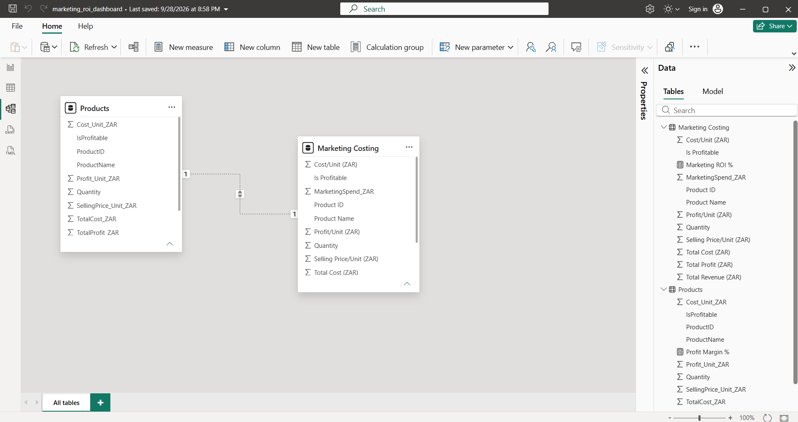
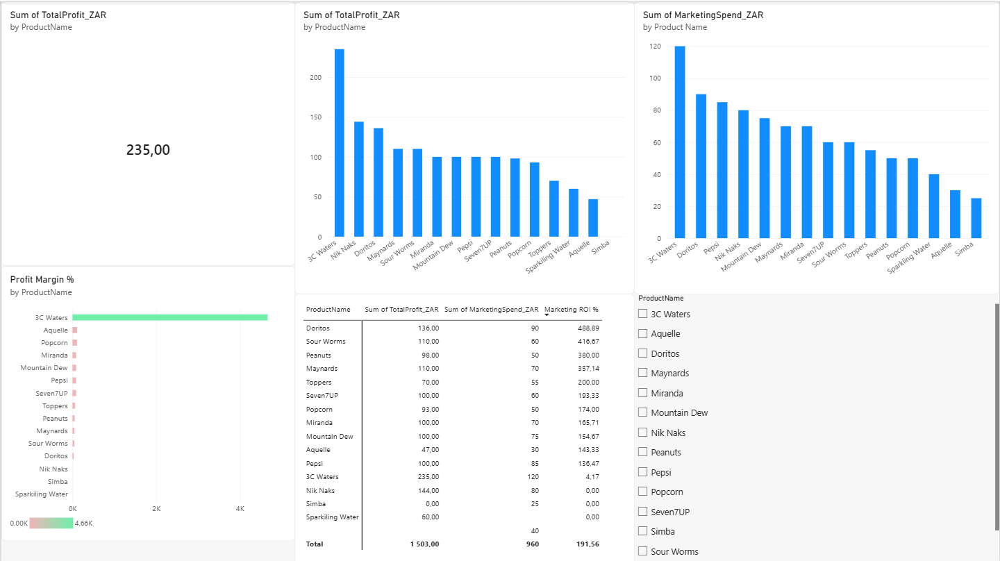
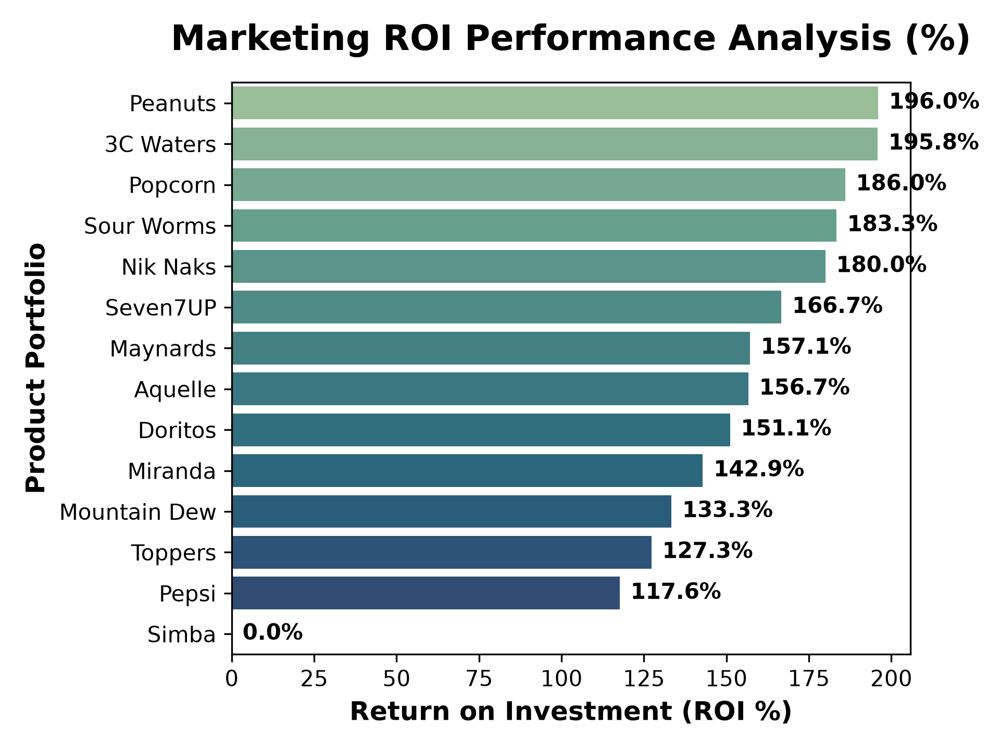
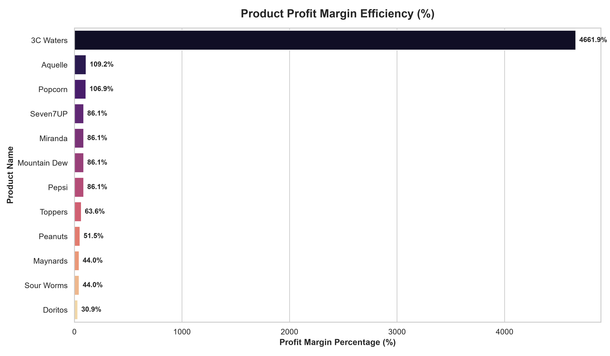
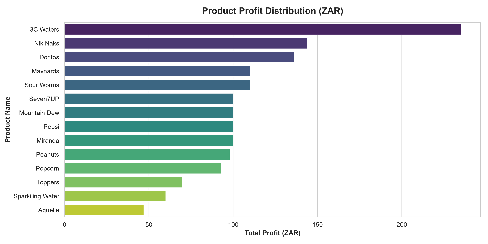

Commercial Optimization & Marketing ROI Analytics Portfolio

BCom Marketing Management portfolio focused on data-driven SME (Small and Medium-sized Enterprises) growth, featuring a commercial optimization study for Coco Bliss. Using Excel, SQL Server, Python (Pandas/Seaborn), and Power BI, I audited a 15+ SKU (Stock Keeping Unit) product mix to eliminate margin leakages and maximize weekly net profitability.

This project demonstrates an end-to-end data engineering and business intelligence pipeline—bridging raw relational databases with interactive, production-ready executive dashboards.

## 🚀 Key Features & Capabilities
* **Relational Database Architecture:** Structured T-SQL schemas managing inventory layers, transaction logs, and underlying cost metrics.
* **Automated Data Pipelines:** Programmatic extraction and database management using Python backend scripts.
* **Algorithmic Cost Analytics:** Automated evaluation of product profit margins and marketing return on investment (ROI %).
* **Interactive Business Intelligence:** Dynamic Power BI visualizations incorporating cross-filtering, product efficiency matrices, and performance tracking.

## 📁 Repository Structure & Artifacts

### 📊 Business Intelligence & Reporting (POWER BI)
* **`marketing_roi_dashboard.pbip`** — The core Power BI project structure containing data modeling, DAX measures, and dashboard views.
* **`marketing_roi_dashboard.pdf`** — A presentation-ready executive export of the dynamic tracking dashboard.
* **`marketing_costing.xlsx`** — Core marketing expense sheets, tracking spend and itemized cost allocations.

#### 🧮 Core DAX Measures Integrated
The business intelligence layers leverage precise, explicit Data Analysis Expressions (DAX) to evaluate operational metrics across the dataset:

* **Marketing ROI %**
  ```dax
  Marketing ROI % = DIVIDE(SUM('Products'[TotalCost_ZAR]), SUM('Marketing Costing'[MarketingSpend_ZAR]), 0) * 100
  ```
* **Profit Margin %**
  ```dax
  Profit Margin % = DIVIDE(SUM('Products'[Profit_Unit_ZAR]), SUM('Products'[Cost_Unit_ZAR]), 0) * 100
  ```

  #### 🖥️ Power BI Model & Dashboard Previews
The interactive business intelligence layer features a comprehensive star-schema data model mapping product dimensions to operational costing tables, paired with dynamic executive views tracking key profitability trends.
### Data Model Relationships


### Interactive Executive Dashboard


---

### 🐍 Python Data Pipelines & Automation
* **`marketing_roi_report.py`** — Main analytical engine utilizing Pandas for data manipulation and Seaborn/Matplotlib for reporting visualizations.
* **`fetch_inventory.py`** — Database connectors facilitating automated, live dataset extractions from local server storage.
* **`inventory_chart.py`** — Programmatic visualization script plotting operational stock availability and trends.

### 🗄️ Database Management
* **`SQLQuery1database_setup.sql`** — Production-ready SQL script defining constraints, primary keys, relational schemas, and baseline dataset seeding.

### 🖼️ Diagnostic Dashboards & Visualization Previews
The diagnostic charts stored within the `MarketingDataAnalyticsPortfolio/` directory were programmatically generated via **Python script automation using the Seaborn and Matplotlib visualization libraries**:

* **`marketing_roi_efficiency.png`** — Programmatic distribution plot displaying return on marketing investments per product.
  
  
* **`product_margin_efficiency_chart.png`** — Automated horizontal bar matrix tracking unit profit parameters against manufacturing cost variables.
  
  
* **`product_profit_chart.png`** — Diagnostic data plot summarizing raw weekly net yields across all tracked operational SKUs.
  

---

## ⚙️ Development Methodology & Tech Stack
* **Analytics & Engineering:** Python (Pandas, NumPy, Seaborn, Matplotlib)
* **Database Administration:** Microsoft SQL Server (T-SQL)
* **Business Intelligence:** Power BI Desktop, DAX Studio
* **Core Logic:** Microsoft Excel

*Rather than writing boilerplate structural frameworks from scratch, my modern workspace workflow heavily incorporates advanced AI orchestration and expert-level prompt engineering. I leverage generative models to structure, refactor, and accelerate script creation while personally owning system architecture, debugging, database modeling, validation, and commercial strategic alignment.*

---
Developed by Jesus Kazaji | BCom Marketing Management
